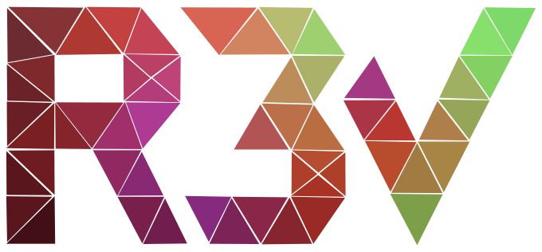

<p align="center">
  
</p>

<h1 align="center">r3v-voxelizer</h1>

<p align="center">
  Turns point clouds into an occupancy voxel map by ray casting.<br>
  Rust library with C, C++, Python and JavaScript bindings.
</p>

<p align="center">
  <a href="https://github.com/igorosky/r3v-voxelizer/actions/workflows/ci.yml"></a>
  <a href="https://igorosky.github.io/r3v-voxelizer/"></a>
</p>

---

You give the voxelizer a sensor position and the points it measured. For every
point it casts a ray from the sensor: the voxel where the ray ends gets more
occupied, every voxel the ray passes through gets less occupied. Over time
real obstacles build up and things that moved away disappear.

The voxelizer reports which voxels changed after every call, so a consumer
(like [r3v-renderer](https://github.com/igorosky/r3v-renderer)) only has to
update what is new.

## Features

- Three implementations behind one `Voxelizer` trait:

  | Implementation | Cargo feature | Notes |
  |---|---|---|
  | `SingleThreaded` | `single_threaded` (default) | Simple, no extra threads |
  | `MultiThreaded` | `multi_threaded` | Uses a rayon thread pool, not available in JS |
  | `WgpuAccelerated` | `wgpu` | Compute shader on the GPU (Vulkan, Metal, DX12, WebGPU) |

- Compact output: with `compress` on, changes come as 32 bit occupancy masks
  of 4x4x2 voxel blocks, ready for r3v-renderer.
- Whole map dumps, as raw values or as 64x64x64 occupancy groups.
- Optional downsampling: a coarser map (one voxel per 2^3 up to 128^3 voxels)
  reported in the same block format, at no cost while it is off.
- Thresholds with hysteresis, a value cap and per call multipliers that can be
  changed at runtime.
- Bindings for C, C++, Python and JavaScript (WebAssembly, with the GPU
  implementation on WebGPU).

## Quick start

Add the crate (it is not on crates.io yet):

```toml
[dependencies]
r3v-voxelizer = { git = "https://github.com/igorosky/r3v-voxelizer" }
# features = ["multi_threaded", "wgpu"] for the other implementations
```

```rust
use r3v_voxelizer::geometry::PointF;
use r3v_voxelizer::{Multipliers, SingleThreaded, Voxelizer, VoxelizerParams};

fn main() {
    let mut voxelizer = SingleThreaded::new(VoxelizerParams {
        resolution: 0.1, // voxel edge length, in the units of the points
        multipliers: Multipliers { intensity: 1.0, hit: 1, target: 2 },
        destroy_threshold: 0,
        construct_threshold: 2,
        max_value: 10,
        compress: true,
    });

    let sensor = PointF { x: 0.0, y: 0.0, z: 0.0, i: 1.0 };
    let points = [PointF { x: 1.0, y: 0.5, z: 0.2, i: 1.0 }];

    // With compress on: one PointI per changed 4x4x2 block,
    // x, y, z is the block origin and i its occupancy mask.
    for block in voxelizer.add_points(sensor, &points) {
        println!("{block:?}");
    }
}
```

`MultiThreaded::new(params, thread_count)` returns a `Result`.
`WgpuAccelerated::new(params, bucket_count)` is async and returns `None` when
there is no usable GPU (`pollster::block_on` works fine outside async code).

## Other languages

Build the library with the feature of your language. Add `wgpu` (for example
`--features c,wgpu`) to get the GPU implementation as well.

| Language | Build | You get |
|---|---|---|
| C | `cargo build --release --features c` | `target/release/libr3v_voxelizer.so`, header `bindings/r3v-voxelizer.h` |
| C++ | `cargo build --release --features cpp` | `target/release/libr3v_voxelizer.so`, header `bindings/r3v-voxelizer.hpp` |
| Python | `cargo build --release --features python` | `target/release/libr3v_voxelizer.so`, rename it to `r3v_voxelizer.so`; type stubs in `bindings/r3v_voxelizer.pyi` |
| JavaScript | `wasm-pack build --release --target web --features js` | `pkg/` with the module and TypeScript types |

<details>
<summary><b>C</b></summary>

```c
#include "r3v-voxelizer.h"

void *voxelizer = create_single_threaded_voxelizer(
    0.1f, 1.0f, 1, 2, 0, 2, 10, true);  /* resolution, multipliers, thresholds, max_value, compress */

PointF sensor = {0.0f, 0.0f, 0.0f, 1.0f};
PointF points[] = {{1.0f, 0.5f, 0.2f, 1.0f}};
VoxelsUpdate update = add_points(voxelizer, sensor, points, 1);
for (size_t k = 0; k < update.len; k++) {
    /* update.data[k].x, .y, .z, .i */
}
drop_update(update);
drop_voxelizer(voxelizer);
```

Link with `-lr3v_voxelizer`. Every function accepts NULL.
</details>

<details>
<summary><b>C++</b></summary>

```cpp
#include "r3v-voxelizer.hpp"
namespace rv = r3v::voxelizer;

void *voxelizer = rv::create_single_threaded_voxelizer(0.1f, 1.0f, 1, 2, 0, 2, 10, true);
rv::PointF sensor{0.0f, 0.0f, 0.0f, 1.0f};
rv::PointF point{1.0f, 0.5f, 0.2f, 1.0f};
rv::VoxelsUpdate update = rv::add_points(voxelizer, sensor, &point, 1);
std::vector<rv::PointI> blocks(update.data, update.data + update.len);
rv::drop_update(update);
rv::drop_voxelizer(voxelizer);
```
</details>

<details>
<summary><b>Python</b></summary>

```python
import r3v_voxelizer as rv

voxelizer = rv.SingleThreaded(
    resolution=0.1, intensity_multiplier=1.0, hit_multiplier=1, target_multiplier=2,
    destroy_threshold=0, construct_threshold=2, max_value=10, compress=True)

update = voxelizer.add_points(rv.PointF(0.0, 0.0, 0.0, 1.0), [rv.PointF(1.0, 0.5, 0.2, 1.0)])
for block in update:
    print(block.x(), block.y(), block.z(), block.i())
```
</details>

<details>
<summary><b>JavaScript</b></summary>

```js
import init, * as rv from "./pkg/r3v_voxelizer.js";

await init();
const voxelizer = new rv.SingleThreaded(0.1, 1.0, 1, 2, 0, 2, 10, true);
const update = voxelizer.add_points(
  new rv.PointF(0, 0, 0, 1),
  [{ x: 1.0, y: 0.5, z: 0.2, i: 1.0 }],  // PointF or plain objects
);
voxelizer.free();

// GPU version, everything is async there:
const gpu = await rv.WgpuAccelerated.create(0.1, 1.0, 1, 2, 0, 2, 10, true, 4096);
const gpuUpdate = await gpu.add_points(new rv.PointF(0, 0, 0, 1), [{ x: 1, y: 0.5, z: 0.2, i: 1 }]);
```
</details>

More about each binding (GPU setup, freeing memory, async rules in JS) is in
[docs/bindings.md](docs/bindings.md).

## Parameters

Every voxelizer is created with the same parameters (in this order outside
Rust):

| Parameter | Meaning |
|---|---|
| `resolution` | Voxel edge length. Point coordinates are divided by it. |
| `intensity_multiplier` | Scales the intensity of each point before it is truncated to an integer. `1.0` keeps it. |
| `hit_multiplier` | Taken from every voxel a ray passes through, times the point intensity. |
| `target_multiplier` | Added to the voxel a ray ends in, times the point intensity. |
| `destroy_threshold` | A constructed voxel is destroyed at or below this value. |
| `construct_threshold` | A voxel is constructed when it reaches this value. |
| `max_value` | Voxel values stop growing here. `4294967295` (`u32::MAX`) means no cap. |
| `compress` | Report changes as 4x4x2 block masks instead of voxel values. |

The full description, with what `add_points` returns and how to dump the map,
is in [docs/parameters.md](docs/parameters.md).

## Documentation

| Document | What is inside |
|---|---|
| [docs/parameters.md](docs/parameters.md) | Parameters, output formats, multipliers, map dumps, downsampling |
| [docs/bindings.md](docs/bindings.md) | C, C++, Python and JavaScript details |
| [docs/benchmarks.md](docs/benchmarks.md) | `bench.sh`, the quick check for optimization work, flamegraphs |

## Development

```bash
./test.sh                 # clippy (warnings are errors) and tests, every group
./test.sh core            # one group: core, c, python or js
cargo fmt --all --check
./coverage.sh             # line coverage, lcov files in target/coverage
```

- The GPU tests need a Vulkan device. The software driver lavapipe
  (`mesa-vulkan-drivers`) is enough.
- `c` needs a C and C++ compiler, `python` needs `python3`, `js` needs
  `wasm-pack`, the `wasm32-unknown-unknown` target, Node and `npm ci` in
  `tests/js`.
- Builds with `c` or `cpp` regenerate the headers in `bindings/`. Commit them,
  CI checks they are up to date.
- `python`, `js` and `c`/`cpp` cannot be combined in one build, and `js` does
  not work with `multi_threaded`.
- `coverage.sh` needs
  [cargo-llvm-cov](https://github.com/taiki-e/cargo-llvm-cov). It runs the
  tests and the C, C++ and Python binding suites (`./coverage.sh core` for one
  group). The JS suite is not measured, wasm can not be instrumented.
- The coverage report for master is at https://igorosky.github.io/r3v-voxelizer/.
  Pull requests with the `coverage` label get a summary comment and the
  report as a run artifact, plus a report of the changed lines.

## Part of r3v

| Repository | What it does |
|---|---|
| **r3v-voxelizer** | Point clouds to occupancy voxel map (this repository) |
| [r3v-renderer](https://github.com/igorosky/r3v-renderer) | Headless renderer for the voxel map and robot models |
| [r3v-ros](https://github.com/igorosky/r3v-ros) | ROS 2 nodes that put both together and publish images |
| [r3v-web](https://github.com/igorosky/r3v-web) | Browser viewer for the rendered stream |
